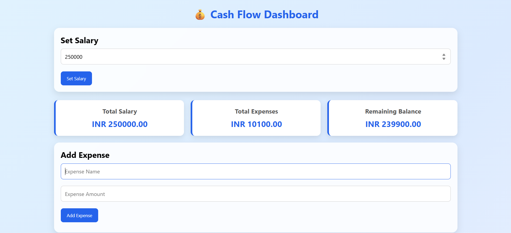
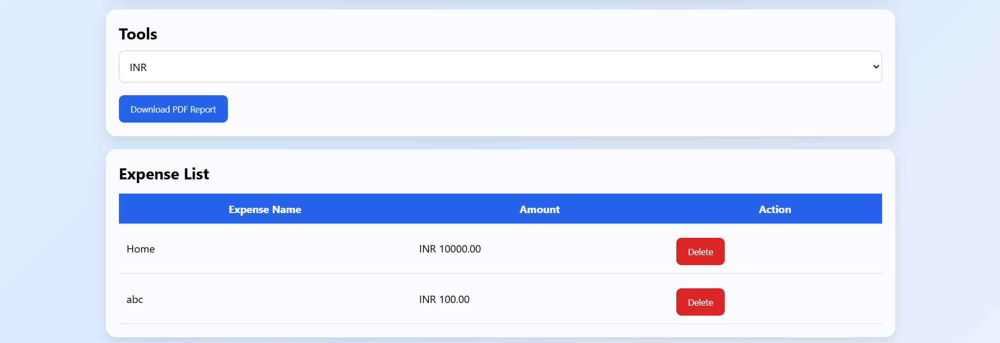
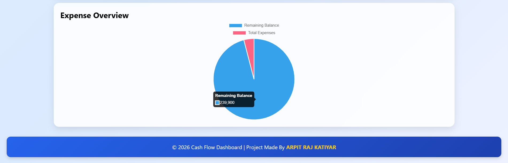
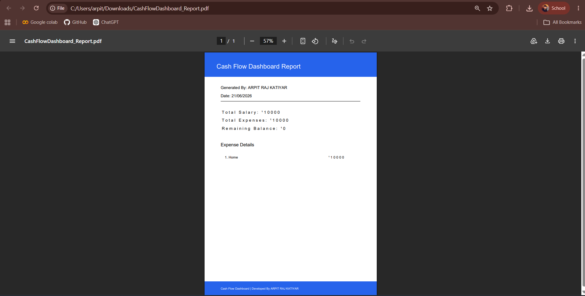

# Cash Flow Dashboard

A personal finance management dashboard built using HTML, CSS, and Vanilla JavaScript.

## Features

* Set Total Salary
* Add Expenses
* Delete Expenses
* Remaining Balance Calculation
* LocalStorage Persistence
* Chart.js Pie Chart
* PDF Report Download
* Currency Toggle (INR, USD, EUR)
* Low Balance Warning
* Responsive Design

## Technologies Used

* HTML5
* CSS3
* JavaScript (Vanilla JS)
* Chart.js
* jsPDF

## Live Demo

<https://cash-flow-dashboard-zeta.vercel.app/>

## Screenshot

Dashboard

PDF Download

## Author

Arpit Raj Katiyar

## Sprint

Prodesk IT Sprint 02 - Cash Flow Dashboard
